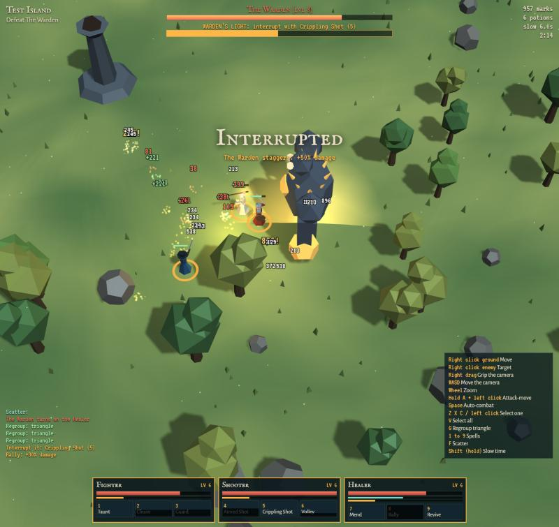

# The New Frontier

**A free, open-source 3D squad RPG for your browser. Command three characters at once, level them up, and help the frontier reach new cities.**

*Early squad test. The Shooter has just interrupted the boss's charged blast.*

> **Status: early development.** The squad prototype works, and the first public build is on its way.

## Purpose

In 2018-2019 as part of studying computer science, I deepened my understanding of C and fundamental algorithms and data structures by writing a text RPG inspired by an MMORPG I played when I was younger. It ran to nearly 5,000 lines, but was only terminal-based. Now with Claude Code, I wanted to port it into a quick and simple 3D game.

The New Frontier expands my original text-based port into a full-fledged 3D game.

| In 2019 | In The New Frontier |
|---|---|
| Damage multiplied by 3 | Three characters you command at once |
| A comment describing a heal | A Healer who keeps your squad alive |
| An auto-battler for testing levelling | `Space` for auto-combat, which also tests the game in CI |
| Upgrade odds that ran backwards | Risky upgrades that work as promised |

## What it plays like

- **Three bodies, one player.** Your squad fights by itself. You decide where they stand and when to spend their spells.
- **Choices that sting.** XP splits among the living, and every upgrade past +4 can destroy the item.
- **No grind.** Auto-combat handles what is dull, and bosses need you at the controls.

## How it's made

I direct this project, and it is built with [Claude Code](https://claude.com/claude-code). Every change starts as a written brief, and every significant choice is logged:

- [Vision](VISION.md) and [roadmap](docs/ROADMAP.md)
- [Decision register](docs/DECISIONS.md)
- [Implementation briefs](docs/briefs/)
- [Current state](STATE.md)

## The original

The 2019 game is preserved, bugs and all, in [`legacy/`](legacy/) and at the tag [`v0-2019`](../../tree/v0-2019).

## Licence

New code is [MIT](LICENSE). The files in `legacy/` are excluded: see [NOTICE](NOTICE).
