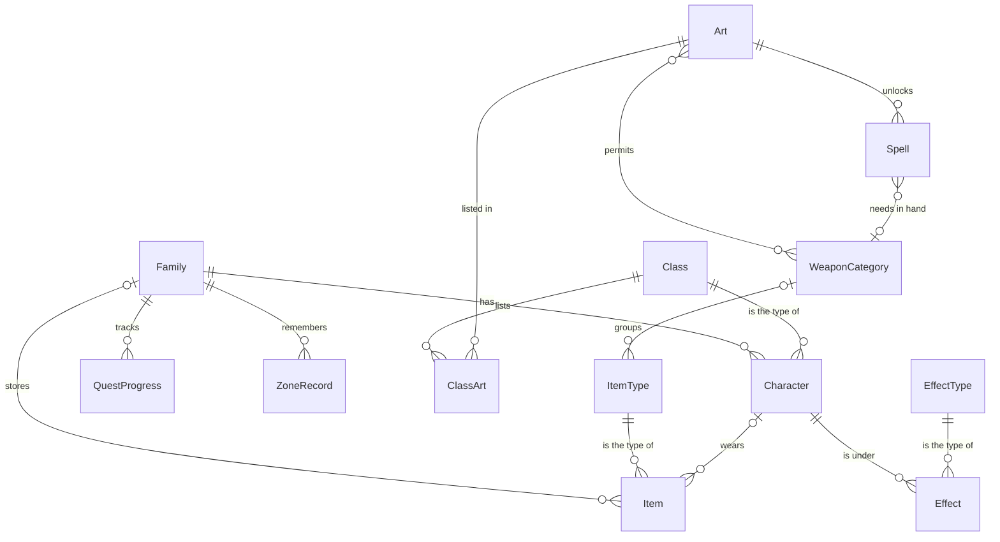
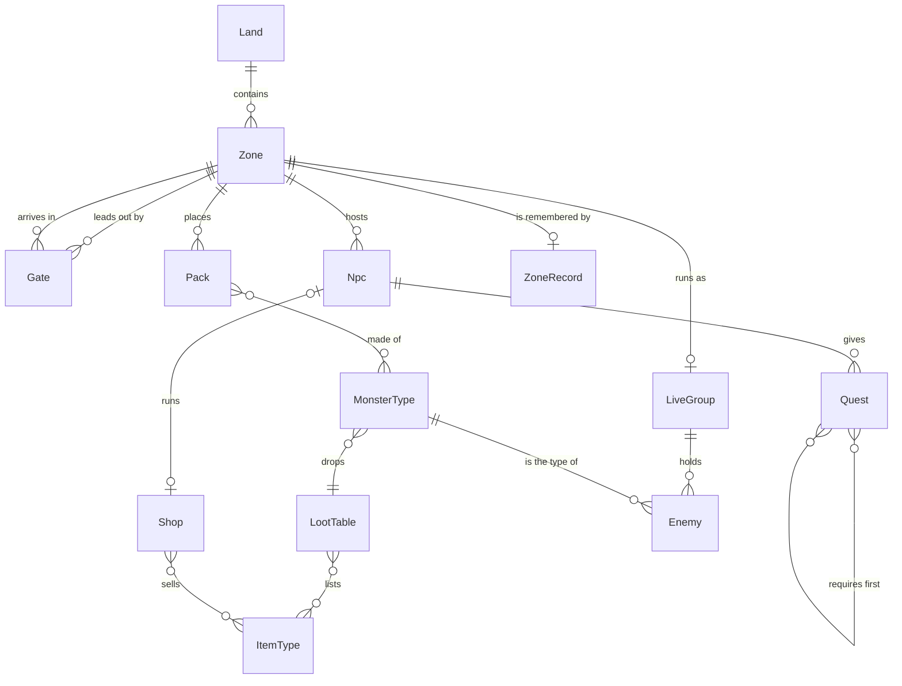

# Data model

What the game is made of, how the parts relate, and why each data structure was chosen. Rules and decisions live in `docs/DECISIONS.md`, and package boundaries live in `ARCHITECTURE.md`.

This document is conceptual. It names entities, relationships and the rules between them. Exact fields live in the TypeScript types in `packages/core`, so that the two cannot disagree.

Much of this is planned. The **Status** column in each table says what exists today:

| Status | Meaning |
|---|---|
| Built | Works in `master` as described |
| Partial | Exists in a simpler form |
| Planned | Agreed, not built |

## The central idea: definitions and instances

Every entity is one of two kinds (D-029).

- **A definition** is fixed game data. It lives in `packages/core/data`, ships with the game and is never saved.
- **An instance** is something that changes during play. It lives in game state and points at its definition by ID.

| Definition | Instance |
|---|---|
| Class | Character |
| Item type | Item |
| Monster type | Enemy |
| Zone | Zone record, and the live group |
| Quest | Quest progress |
| Effect type | Effect |

This is the same split as code and data (D-018), and it decides what a save holds: instances, and IDs pointing at definitions.

## Glossary

| Term | Meaning |
|---|---|
| Art | A body of learning that unlocks spells and weapon categories |
| Attribute | One of a character's five core abilities: STR, RAN, MAG, VIG or NIM. Attributes feed stats |
| Character | One member of the family, such as a particular Fighter |
| Class | The type of a character: Fighter, Sniper or Healer (D-020). Wizard and Elementalist are working names, still to be designed |
| Definition | Fixed game data, never saved |
| Family | Everything the player owns: characters, the store, marks and progress |
| Field | A zone of kind `field`: open and unsafe |
| Dungeon | A zone of kind `dungeon`: enclosed and unsafe. Each floor is its own zone |
| Gate | A one-way link out of a zone into another. A two-way link is two gates |
| Grid | A zone's walkable ground, as square cells one world unit across. Built from the zone's data, never saved |
| Instance | Something that changes in play, and points at a definition |
| Item | One specific piece of gear, with its own upgrade level |
| Item type | The definition of a piece of gear, such as a level 20 pistol |
| Land | A named group of zones |
| Live group | Everything that exists only while a zone runs: enemies, shots, drops and scheduled effects |
| Marks | The family's money |
| Route | The corners a character walks through to reach a point, found on the grid by A\* |
| Stat | One named number on a character or enemy |
| Store | The family's shared items |
| Town | A zone of kind `town`: safe, with NPCs. The vision's cities are towns |
| Zone | One playable space with its own ground, coordinates and monsters. Its ground is an island with a coast or a rectangle with walls |
| Zone record | What lasts about a zone: bosses dead, chests opened, when cleared packs come back |

## Entity relationships

### Family, characters and gear



An item is either in the store or on one character, never both.

### World, monsters and NPCs



Only one zone runs at a time, so there is at most one live group (D-021). The live group is dropped when the squad leaves its zone, and built fresh from the zone's data and record when the squad arrives.

## Entity catalogue

### Family side

| Entity | Kind | Saved | Status | Notes |
|---|---|---|---|---|
| Family | Instance | Yes | Partial | Today `marks` and `potions` sit directly on `GameState` |
| Character | Instance | Yes | Partial | Today `Unit` also holds the live body and calculated stats. These split in S3 |
| Class | Definition | No | Built | `CLASSES`. Weapon-like values move to item types in S3 |
| Art | Definition | No | Planned | Each class starts with one, covering its three spells |
| Spell | Definition | No | Built | `SPELLS`. Today spells belong to a class directly |
| Weapon category | Definition | No | Planned | Rifle, pistol, spear and so on |
| Item type | Definition | No | Partial | Will hold slots, stats, requirements and price. Today only `ARMOUR`, a shared table by slot |
| Item | Instance | Yes | Partial | Today `GearItem` takes weapon stats from the class, and armour stats from `ARMOUR` |
| Effect type | Definition | No | Planned | Says how repeats stack |
| Effect | Instance | Live only | Partial | Today separate timers, such as `guardTicks`, `rallyTicks` and `slowTicks` |
| Consumable | Open | Open | Partial | Today a shared count, `potions`. The design is open |

### World side

| Entity | Kind | Saved | Status | Notes |
|---|---|---|---|---|
| Land | Definition | No | Planned | A name, a level range and a place on the world map. No rules of its own |
| Zone | Definition | No | Built | `ZONES`: Lande de Montclaire and a cave off it. Holds its ground, camp, anvil, baked obstacles, packs, boss, gates and place in the world frame. Only the zone named on state runs |
| Gate | Definition | No | Partial | On the zone it leaves: an area, the zone it arrives in, an arrival point and heading. Requirements and cost are held in the shared requirement shape, but nothing checks them yet |
| Zone record | Instance | Yes | Built | `state.records`: whether the boss is dead, and the game tick each cleared pack comes back. Saved from S3c |
| Live group | Instance | No | Built | `state.live`: enemies, shots, enemy shots, scheduled effects and drops |
| Pack | Definition | No | Built | `PACKS` and the cave's pack, held on the zone. Comes back on the game clock after it is cleared |
| Grid | Derived | No | Built | Built from the zone's ground, walls and obstacles the first time the zone runs, and kept. Never in state |
| Monster type | Definition | No | Built | `MONSTERS`, `BOSS` and `DUMMY` |
| Enemy | Instance | No | Built | Keeps its own stats, because level scales them |
| Loot table | Definition | No | Partial | Today `LOOT`, and `coins` on each monster |
| Drop | Instance | No | Built | Loot on the ground |
| NPC | Definition | No | Planned | |
| Shop | Definition | No | Planned | D-012 |
| Quest | Definition | No | Planned | |
| Quest progress | Instance | Yes | Planned | |
| Save | Instance | Is the save | Planned | D-024 |

## Rules that must always hold

Each rule should have a test or a validator check once it is built. The world's checks are in `packages/core/src/checks.ts`, and each is also tested against a deliberately broken zone.

1. A gear item is in exactly one place: the store, or one character's slot.
2. A two-handed weapon in the main hand means an empty off hand.
3. Final stats are calculated, never saved.
4. Definitions never change during play.
5. Nothing outside the live group refers to an enemy once its zone has closed. Checked after every crossing in tests.
6. Every zone can be reached from the start, every gate arrives on a walkable cell, and every pack and camp stands on one. Reachability is checked by breadth-first search over gates.
7. A crossing never strands the player: every land can earn enough to leave it, or the way back is free.
8. Quest prerequisites contain no loops.
9. Content IDs are never deleted or reused without a save migration.

## How stats are worked out

The order is fixed, so the same inputs always give the same result (D-026).

```text
attributes = class value + level growth + spent points + item boosts
stats      = worked out from attributes
total      = stats + each item's stats × its upgrade
final      = total × effects, then any cap
```

### Attributes

Attributes are for characters only. Each class has its own starting values and growth. Most growth is automatic, and players also get a few points to spend each level, with a cheap way to reset them. Spent points arrive after automatic growth is working, and are saved on the character.

| Attribute | Feeds |
|---|---|
| Strength (STR) | Melee attack |
| Ranged ability (RAN) | Ranged attack, accuracy |
| Magical ability (MAG) | Magic attack, mana |
| Vigour (VIG) | Health |
| Nimbleness (NIM) | Attack speed, evade |

This table is data, so changing what an attribute feeds needs no change to code. Crit, defence and block have no attribute, and come from items and classes. Nimbleness never changes walking speed, because the squad moves as a triangle.

### Stats

Stats are a named list, so adding one means one new entry:

| Group | Stats |
|---|---|
| Resources | Health, mana, mana regeneration |
| Offence | Melee, ranged and magic attack, attack speed, accuracy, crit chance, crit damage |
| Defence | Defence, evade, block, one resistance per damage type |
| Movement | Speed |

Monsters use the same stat sheet as characters, with their numbers set directly, so they skip attributes. Items may boost any attribute or stat, so item boosts need no new structure when they arrive.

## How a hit is worked out

A single function resolves every hit, in this order:

1. **Accuracy against evade:** a multiplier, with no random misses.
2. **Block:** a chance, which comes from shields.
3. **Crit:** a chance.
4. **Defence and resistance:** both reduce damage, up to their caps.
5. **Minimum damage:** a hit always does at least 1.

## What can be used

A character may equip an item if every requirement on its item type is met. Requirements are one shape, used by item types, spells, gates and quests: an art known, a level reached, a quest finished.

A spell needs its art, and a matching weapon in hand unless it names none. Healing arts name none.

## Data structures

A structure enters only when a real need demands it, and the brief that adds it says why it won (D-029).

| Structure | Used for | Why this one | Status |
|---|---|---|---|
| Hash map keyed by ID | All definitions | Direct lookup by ID. Today `CLASSES`, `SPELLS` and `MONSTERS` | Partial |
| Seeded generator (mulberry32) | Crits, loot, upgrades | Small state that saves as one number, and repeats exactly | Built |
| FNV-1a hash | Proving a replay matches | Fast, with no dependencies, and good enough to spot change | Built |
| Tree | Lands contain zones | Each zone has exactly one parent | Planned |
| Directed graph, as an adjacency list | Zones and gates | Handles one-way drops, and breadth-first search proves reachability. Each zone lists the gates that leave it | Built |
| Grid | Walkable ground inside a zone | Any position is one lookup away. One byte a cell says whether a character, and whether an enemy, may stand there, and connected areas are labelled once so an unreachable goal is known at once | Built |
| A\* with a binary heap | Routes inside a zone | The heap always gives the most promising cell next. Routes are then smoothed by line of sight, so units walk long straight legs. The longest route on the Lande takes under a millisecond | Built |
| Directed acyclic graph | Quest prerequisites | A topological sort proves that no quest is impossible | Planned |
| State machine | Boss phases, quest status | One named stage at a time, with clear changes between stages. Today the boss only | Partial |
| Sorted array with binary search | XP levels, loot odds | Fast lookup, and it stays plain data | Planned |

The world uses the same idea at two scales. Zones and gates form a coarse graph, and the walkable cells inside a zone form a fine one. A unit walks straight when the line is clear on the grid, and asks A\* only when it is not. Bots stay inside the zone that runs for now; planning which zones to cross waits for a brief that needs it.

## Keeping this document true

Any brief that changes an entity, a relationship or a rule above updates this document, and moves the status as it goes.
