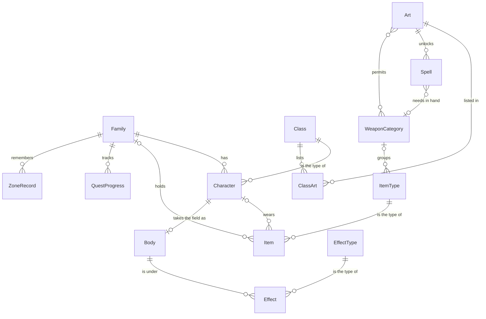
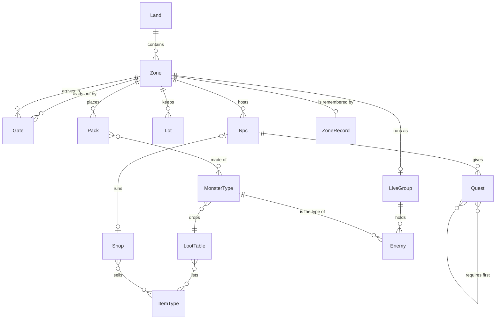

# Data model

What the game is made of, how the parts relate, and why each data structure was chosen. Rules and decisions live in `docs/DECISIONS.md`, and package boundaries live in `ARCHITECTURE.md`.

This document is conceptual. It names entities, relationships and the rules between them. Exact fields live in the TypeScript types in `packages/core`, so that the two cannot disagree.

Much of this is planned. The **Status** column in each table says what exists today:

| Status | Meaning |
|---|---|
| Built | Works in `master` as described |
| Partial | Exists in a simpler form |
| Planned | Agreed, not built |

## The central idea: definitions and instances

Every entity is one of two kinds (D-029).

- **A definition** is fixed game data. It lives in `packages/core/data`, ships with the game and is never saved.
- **An instance** is something that changes during play. It lives in game state and points at its definition by ID.

| Definition | Instance |
|---|---|
| Class | Character |
| Item type | Item |
| Monster type | Enemy |
| Zone | Zone record, and the live group |
| Quest | Quest progress |
| Effect type | Effect |

This is the same split as code and data (D-018), and it decides what a save holds: instances, and IDs pointing at definitions.

## Glossary

| Term | Meaning |
|---|---|
| Art | A body of learning that unlocks spells and weapon categories |
| Attribute | One of a character's five core abilities: STR, RAN, MAG, VIG or NIM. Attributes feed stats |
| Body | A character's live presence in the field: position, orders, route, health, mana, target, timers and calculated stats. It belongs to the squad, not the live group, so a gate moves it whole |
| Character | One member of the family, such as a particular Fighter. What lasts: name, class, level, XP, arts and equipped items |
| Class | The type of a character: Fighter, Sniper or Healer (D-020). Wizard and Elementalist are working names, still to be designed |
| Definition | Fixed game data, never saved |
| Family | Everything the player owns: characters, the inventory, marks and progress |
| Field | A zone of kind `field`: open and unsafe |
| Dungeon | A zone of kind `dungeon`: enclosed and unsafe. Each floor is its own zone |
| Gate | A one-way link out of a zone into another. A two-way link is two gates |
| Grid | A zone's walkable ground, as square cells one world unit across. Built from the zone's data, never saved |
| Instance | Something that changes in play, and points at a definition |
| Inventory | The family's shared items: every item not equipped. Called the store until S3c (D-041) |
| Item | One specific piece of gear: its type plus its upgrade, with its own ID. It may be broken (D-042) |
| Item type | The definition of a piece of gear, such as a level 20 pistol: its category, the slots it fits and fills, stats, requirements and price |
| Land | A named group of zones |
| NPC | Someone placed on a zone: an ID, a name, a point, a list of services and a list of quests. Either list may be empty (D-044) |
| Service | A type on an NPC's list: `smith` is built, and `enhancer`, `bank` and `shop` are to come (D-044) |
| Live group | Everything that exists only while a zone runs: enemies, shots, drops and scheduled effects |
| Marks | The family's money |
| Route | The corners a character walks through to reach a point, found on the grid by A\* |
| Slot | One of seven places a character wears an item: main hand, off hand, head, chest, gloves, boots and necklace |
| Stat | One named number on a character or enemy |
| Unarmed | What an empty main hand fights with. A type in data, not an item |
| Lot | A place in a town kept for a later system, such as the smithy: an ID, a door point on a walkable cell where that system's townsperson will stand, and the way the door faces. Its building is drawn by `render` only (S3d) |
| Street | Part of a town's ground: a centreline through a few points, which can bend, and a width. A town's open places, such as its plaza, are outlines of points (S3d) |
| Town | A zone of kind `town`: safe, with NPCs. The vision's cities are towns. Its ground is its streets and open places, and its buildings are look only |
| Zone | One playable space with its own ground, coordinates and monsters. Its ground is an island with a coast, a rectangle with walls, or a town's streets |
| Save | The lasting part of the game as plain data, in an envelope with a format version. Kept in the browser, and exported and imported as a `.json` file (S3c) |
| Zone record | What lasts about a zone: bosses dead, chests opened, when cleared packs come back |

## Entity relationships

### Family, characters and gear



An item is either in the inventory or on one character, never both. A character in the active three has a body in the field; the body points at its character by ID.

### World, monsters and NPCs



Only one zone runs at a time, so there is at most one live group (D-021). The live group is dropped when the squad leaves its zone, and built fresh from the zone's data and record when the squad arrives.

## Entity catalogue

### Family side

| Entity | Kind | Saved | Status | Notes |
|---|---|---|---|---|
| Family | Instance | Yes | Built | `state.family`: the characters, the active three in order, the inventory, marks and potions (S3b). Saved whole: `packages/core/test/save.test.ts` |
| Character | Instance | Yes | Built | ID, name, class, level, XP, arts known and seven slots. Names are placeholders until names are chosen (S3b). Saved whole: `packages/core/test/save.test.ts` |
| Body | Instance | No: rebuilt on load | Built | `state.bodies`, one per character in the active three, in that order. Holds position, orders, route, health, mana, target, timers and calculated stats. A save keeps each body's position, health, mana and whether it is down, and the triangle's centre and heading. Load rebuilds the rest: no orders, route, target or cooldowns, and stats worked out again. A position no longer walkable falls back to the triangle at the zone's camp (S3c). Tested in `packages/core/test/save.test.ts` and `e2e/saves.spec.ts` |
| Class | Definition | No | Built | `CLASSES`: speed, health, mana, armour skill, auto-heal, ranges, arts and starting items. Weapon values moved to item types in S3b |
| Art | Definition | No | Partial | `ARTS`: one per class, known from the start, unlocking its three spells and its weapon categories. Trainers, and arts gained later, come with the town |
| Spell | Definition | No | Built | `SPELLS`. Each belongs to an art, and `SPELL_WEAPONS` names the weapon it needs in hand, if any |
| Category | Definition | No | Built | `CATEGORIES`: sword, great sword, dagger, spear, pistol, rifle, staff and shield are weapons; leather, metal, coat and jewellery are armour. More can be added as data |
| Item type | Definition | No | Built | `ITEM_TYPES`: category, slots it fits and fills, stats, weapon values, requirements and price. The plain types, quality and spare went in S3e (D-042). Item boosts come later (D-028) |
| Item | Instance | Yes | Built | Type ID, upgrade, whether it is broken (D-042), and an ID from `nextItemId`, a counter of its own. A broken item keeps its type and the level it broke at, and cannot be worn. The counter is not saved: load sets it one above the highest item ID in the save (S3c). Tested in `packages/core/test/upgrades.test.ts` and `packages/core/test/save.test.ts` |
| Inventory | Instance | Yes | Built | `state.family.inventory`: every item not equipped. A new family starts with a cap, a buckler and a necklace. Named the store until S3c (D-041). Saved whole: `packages/core/test/save.test.ts` |
| Effect type | Definition | No | Planned | Says how repeats stack |
| Effect | Instance | Live only | Partial | Today separate timers, such as `guardTicks`, `rallyTicks` and `slowTicks` |
| Consumable | Open | Open | Partial | Today a shared count, `potions`. The design is open |

### World side

| Entity | Kind | Saved | Status | Notes |
|---|---|---|---|---|
| Land | Definition | No | Planned | A name, a level range and a place on the world map. No rules of its own |
| Zone | Definition | No | Built | `ZONES`: Lande de Montclaire, a cave off it, and the town of Montclaire (S3d). Holds its ground, camp, baked obstacles, packs, boss, gates, lots, NPCs and place in the world frame. Only the zone named on state runs |
| Town | Definition | No | Built | A zone of kind `town`. Montclaire, in `packages/core/data/montclaire.ts`: a plaza, a loop of streets and a gate street, hand-placed (D-022). No packs, boss or dummy, so no fight happens there. A player's new game starts in its plaza (`TOWN_SCENARIO`); bots, replays and test pages start on the Lande. Its smith stands at the smithy's door (S3e). Tested in `packages/core/test/town.test.ts` and `e2e/town.spec.ts` |
| Street | Definition | No | Built | On a town's ground, with its open places: the grid opens every cell whose centre is a character's radius inside a street or place (S3d). Each of Montclaire's is 12 wide |
| Lot | Definition | No | Built | `lots` on the zone: the smithy, the shop and the inn in Montclaire. The smith stands at the smithy's door; the others wait for their briefs |
| Gate | Definition | No | Partial | On the zone it leaves: an area, the zone it arrives in, an arrival point and heading. Requirements and cost are held in the shared requirement shape, but nothing checks them yet |
| Zone record | Instance | Yes | Built | `state.records`: whether the boss is dead, and the game tick each cleared pack comes back. Saved from S3c, without a test scenario's contents. A zone added since a save starts with a fresh record. Tested in `packages/core/test/save.test.ts`, where a cleared pack comes back on the same tick after a load |
| Live group | Instance | No | Built | `state.live`: enemies, shots, enemy shots, scheduled effects and drops |
| Pack | Definition | No | Built | `PACKS` and the cave's pack, held on the zone. Comes back on the game clock after it is cleared |
| Grid | Derived | No | Built | Built from the zone's ground, walls and obstacles the first time the zone runs, and kept. Never in state |
| Monster type | Definition | No | Built | `MONSTERS`, `BOSS` and `DUMMY` |
| Enemy | Instance | No | Built | Keeps its own stats, because level scales them |
| Loot table | Definition | No | Partial | Today `LOOT`, and `coins` on each monster |
| Drop | Instance | No | Built | Loot on the ground |
| NPC | Definition | No | Partial | `npcs` on the zone (S3e, D-044). The smith is the first, and only `smith` works. Quest lists exist and stay empty. Talking is a read, `whyNotTalk`, refused while any enemy is awake. A data check, `badNpcs`, holds a smith to towns. Tested in `packages/core/test/upgrades.test.ts`, `packages/core/test/zones.test.ts` and `e2e/smith.spec.ts` |
| Shop | Definition | No | Planned | D-012 |
| Quest | Definition | No | Planned | |
| Quest progress | Instance | Yes | Planned | Joins the save through a migration step when quests arrive (S3c) |
| Save | Instance | Is the save | Built | D-024, D-032. `toSave` and `fromSave` in `packages/core/src/save.ts`, the migration chain in `src/migrations.ts`, the browser store in `packages/app/src/saves.ts`. See [Saves](#saves). Tested in `packages/core/test/save.test.ts`, `packages/app/test/saves.test.ts` and `e2e/saves.spec.ts` |

## Rules that must always hold

Each rule should have a test or a validator check once it is built. The world's checks are in `packages/core/src/checks.ts`, and each is also tested against a deliberately broken zone.

1. A gear item is in exactly one place: the inventory, or one character's slot. Tested across random equips and unequips in `packages/core/test/items.test.ts`.
2. A two-handed weapon in the main hand means an empty off hand. Tested in the same file: equipping either one sends the other to the inventory.
3. Final stats are calculated, never saved.
4. Definitions never change during play.
5. Nothing outside the live group refers to an enemy once its zone has closed. Checked after every crossing in tests.
6. Every zone can be reached from the start, every gate arrives on a walkable cell, and every pack and camp stands on one. Reachability is checked by breadth-first search over gates.
7. A crossing never strands the player: every land can earn enough to leave it, or the way back is free.
8. Quest prerequisites contain no loops.
9. Content IDs are never deleted or reused without a save migration, as S3e's step 1 does for the plain item types. A save naming a class, art, item type, zone or pack this build lacks is refused, in `packages/core/test/save.test.ts`. Saves hold no gate IDs.

## Saves

A save is the lasting part of the game, and nothing that can be worked out again (D-024, S3c).

| Saved | Not saved |
|---|---|
| The family: characters with their levels, XP, arts and equipped items, the inventory, the active three in order, marks and potions | The live group: enemies, shots, drops and scheduled effects. Load builds it fresh, as entering the zone does |
| Each zone record: the boss dead, and when each cleared pack comes back | A test scenario's zone contents |
| The zone the squad is in, each body's position, health and mana and whether it is down, and the triangle's centre and heading | Everything else on a body: orders, route, target, cooldowns and calculated stats |
| The generator's state and the game tick | The ID counters, which load works out: one above the highest character ID, and one above the highest item ID |

- **An envelope and the game.** The envelope holds `format`, `version` and the app's `savedAt`. Version 1 is the first format, and version 2 is today's (S3e).
- **Migration is a chain.** Step *n* moves a save's game data from version *n* to *n* + 1. A save runs every step from its version to the current one, then the check. Steps are never edited once shipped, and each version keeps a frozen example in `packages/core/test/saves/`, which every later build must load. Step 1 retires the plain item types: each becomes the type it stood in for, with its ID and upgrade kept, and every item gains `broken: false` (S3e). It names every ID it retires (rule 9), and its test is "version 1 to 2" in `packages/core/test/save.test.ts`.
- **The check.** The right shape, every content ID in this build's data (rule 9), S3b's item rules (rules 1 and 2), and no broken item in a slot. A save newer than the build, or one that fails the check, is refused and left untouched.
- **Whether the run is won** follows from the boss's zone record, so it is not saved separately.
- **Loading draws from the generator.** Building the zone's packs on load uses the generator, as any entry does. So the rolls after a reload differ from the rolls the run would have had without one. Replays start from `createGame` and never load a save.

## How stats are worked out

The order is fixed, so the same inputs always give the same result (D-026).

```text
attributes = class value + level growth + spent points + item boosts
stats      = worked out from attributes
total      = stats + each item's stats × its upgrade
final      = total × effects, then any cap
```

Until attributes arrive, level still scales attack and health directly (S3b decision 14). Today's sum, in `packages/core/src/stats.ts`: attack from the weapon in hand, or the unarmed type, raised by its upgrade and by level; AR and crit from every item; Def from every other item, scaled by the class's armour skill; DR from every other item plus a point every four levels. Upgrades past +4 add AR on a weapon and DR on anything else.

### Attributes

Attributes are for characters only. Each class has its own starting values and growth. Most growth is automatic, and players also get a few points to spend each level, with a cheap way to reset them. Spent points arrive after automatic growth is working, and are saved on the character.

| Attribute | Feeds |
|---|---|
| Strength (STR) | Melee attack |
| Ranged ability (RAN) | Ranged attack, accuracy |
| Magical ability (MAG) | Magic attack, mana |
| Vigour (VIG) | Health |
| Nimbleness (NIM) | Attack speed, evade |

This table is data, so changing what an attribute feeds needs no change to code. Crit, defence and block have no attribute, and come from items and classes. Nimbleness never changes walking speed, because the squad moves as a triangle.

### Stats

Stats are a named list, so adding one means one new entry:

| Group | Stats |
|---|---|
| Resources | Health, mana, mana regeneration |
| Offence | Melee, ranged and magic attack, attack speed, accuracy, crit chance, crit damage |
| Defence | Defence, evade, block, one resistance per damage type |
| Movement | Speed |

Monsters use the same stat sheet as characters, with their numbers set directly, so they skip attributes. Items may boost any attribute or stat, so item boosts need no new structure when they arrive.

## How a hit is worked out

A single function resolves every hit, in this order:

1. **Accuracy against evade:** a multiplier, with no random misses.
2. **Block:** a chance, which comes from shields.
3. **Crit:** a chance.
4. **Defence and resistance:** both reduce damage, up to their caps.
5. **Minimum damage:** a hit always does at least 1.

## What can be used

A character may equip an item if every requirement on its item type is met, and, for a weapon category, if an art it knows permits that category. Any class may wear any armour, and its armour skill scales it. Requirements are one shape, used by item types, spells, gates and quests: an art known, a level reached, a quest finished. Items check them from S3b; gates do not yet. Equipping and unequipping are refused while any enemy is awake.

A spell needs its art, and a matching weapon in hand unless it names none. Healing arts name none. An empty main hand fights with the unarmed type, so a character never stands idle.

## Data structures

A structure enters only when a real need demands it, and the brief that adds it says why it won (D-029).

| Structure | Used for | Why this one | Status |
|---|---|---|---|
| Hash map keyed by ID | All definitions | Direct lookup by ID. Today `CLASSES`, `SPELLS`, `MONSTERS`, `ARTS`, `CATEGORIES` and `ITEM_TYPES` | Partial |
| Seeded generator (mulberry32) | Crits, loot, upgrades | Small state that saves as one number, and repeats exactly | Built |
| FNV-1a hash | Proving a replay matches | Fast, with no dependencies, and good enough to spot change | Built |
| Tree | Lands contain zones | Each zone has exactly one parent | Planned |
| Directed graph, as an adjacency list | Zones and gates | Handles one-way drops, and breadth-first search proves reachability. Each zone lists the gates that leave it | Built |
| Grid | Walkable ground inside a zone | Any position is one lookup away. One byte a cell says whether a character, and whether an enemy, may stand there, and connected areas are labelled once so an unreachable goal is known at once | Built |
| A\* with a binary heap | Routes inside a zone | The heap always gives the most promising cell next. Routes are then smoothed by line of sight, so units walk long straight legs. The longest route on the Lande takes under a millisecond | Built |
| Directed acyclic graph | Quest prerequisites | A topological sort proves that no quest is impossible | Planned |
| State machine | Boss phases, quest status | One named stage at a time, with clear changes between stages. Today the boss only | Partial |
| Sorted array with binary search | XP levels, loot odds | Fast lookup, and it stays plain data | Planned |

The world uses the same idea at two scales. Zones and gates form a coarse graph, and the walkable cells inside a zone form a fine one. A unit walks straight when the line is clear on the grid, and asks A\* only when it is not. Bots plan across zones with exactly this split (S3e): a breadth-first search over gates gives the route, and A\* walks each zone. Auto-combat stays inside the zone that runs.

## Keeping this document true

Any brief that changes an entity, a relationship or a rule above updates this document, and moves the status as it goes.
